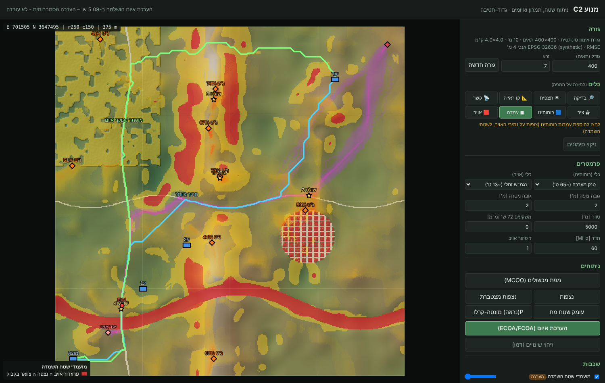

<div dir="rtl" align="right">

# מנוע C2 – ניתוח שטח, תמרון ואיומים (גדוד–חטיבה)

מימוש MVP של האפיונים "ארכיטקטורת מנוע C2/C5ISR מבוסס קוד פתוח" (גרסת Gemini) ו"מערכת תומכת החלטה טקטית לגדוד–חטיבה" (גרסת Claude).


המערכת בנויה משתי שכבות נפרדות, כפי ששני המסמכים דורשים:

* **שכבה דטרמיניסטית** (גיאומטריה ופיזיקה, אין בה "הזיות"): קווי ראייה, נצפות, שטח מת, קשר רדיו ופרנל, עבירות ו-MCOO, צירים.
* **שכבה הסתברותית** (מסומנת תמיד "הערכה"): עמדות נ"ט ומארבים, נתיבי אויב, שטחים שולטים, מועמדי שטחי השמדה, השוואת דרכי פעולה.

השכבה ההסתברותית צורכת את השכבות הדטרמיניסטיות כמאפיינים (features) ולא משנה אותן. כל המשקלות גלויים וניתנים לעריכה.

## הרצה

```bash
cd c2-terrain
pip install -r requirements.txt
uvicorn server.app:app --port 8800
# דפדפן: http://localhost:8800
```

הממשק עובד במלואו ללא אינטרנט (אין תלות ב-CDN). ברירת המחדל היא גזרת אימון סינתטית של 4×4 ק"מ ברזולוציה של 10 מ'. הגזרה כוללת רכס עם אוכף, גבעה שולטת, ואדי, כפר צפוף (לש"ב), יער, כבישים ונחל. משתנה הסביבה `C2_GRID_SIZE` קובע את גודל הגזרה.

בדיקות ומדדי ביצוע:

```bash
python -m pytest            # 30 בדיקות
python scripts/benchmark.py # מדדי KPI
```

## מה ממומש: מיפוי מהאפיון לקוד

| דרישה באפיון | מימוש | קובץ |
|---|---|---|
| קו ראייה בינארי V(p1,p2), נצפות, נצפות מצטברת S(x,y) | Radial ray-sweep (R3/DDA) מוקטר ב-NumPy | `c2engine/visibility.py` |
| עקמומיות ושבירה z_adj = z − cc·d²/2R | cc=0.85714 (GDAL) לאופטי, ‎k=4/3 לרדיו | `visibility.py` |
| עומק שטח מת (viewshed_agl) | גובה נדרש מעל הקרקע כדי להיראות | `visibility.py` |
| אי-ודאות: P(visible) | מונטה-קרלו עם רעש מתואם מרחבית לפי ה-RMSE | `visibility.py` |
| DSM לראייה, DTM לתנועה, ‎ΔH = DSM−DTM | שתי שכבות גובה בכל גזרה | `c2engine/grid.py` |
| מטריצת נצפות הדדית | `intervisibility_matrix` | `visibility.py` |
| אזור פרנל r_F1, סף 0.6, עקיפת Knife-edge | ITU-R P.526 + FSPL + תקציב קשר | `visibility.py` |
| WES Mobility Index → VCI₁ / VCI₅₀, ‏RCI = CI·RI | נוסחאות WES לזחלי ולגלגלי, לחות קרקע ממשקעים | `c2engine/mobility.py` |
| טובלר (רגלי, אניזוטרופי), דגרדציה ריבועית לרק"ם | מהירות לפי כיוון הקשת בגרף | `mobility.py`, `routing.py` |
| MCOO אוטומטי: GO / SLOW / NO GO + provenance | ספי FM 5-33, עקביות מרחבית (≥3 תאים) | `mobility.py` |
| A*/Dijkstra, ‏k צירים מגוונים, פרוזדור CD_A+CD_B ≤ min+Δ | Dijkstra (scipy csgraph) על רשת של 8 שכנים | `c2engine/routing.py` |
| מודל לוגיסטי לעמדות נ"ט (TPI, שיפוע, רכס, V_target, מחסה, LAI) | P = σ(wᵀx+b), משקלות מומחה | `c2engine/threat.py` |
| Softmax routing לאויב: ‏W = α·Cost + β·P(obs) − γ·Concealment | מדיניות Softmax עם cost-to-go (randomized shortest path), τ מווסת פיזור | `threat.py` |
| KTS = w1·TPI + w2·VS∩AoA + w3·BC + w4·Access | BC מקורב מצפיפות צירים | `threat.py` |
| מועמדי שטח השמדה: פרוזדור ∩ נצפה מ-k עמדות ∩ צוואר בקבוק | הצעת מיקום בלבד, ללא תכנון אש | `threat.py` |
| FCOA: מינימום ΣP(visible), מטריצת השוואה | מהיר מול מוסתר, עם חשיפה ‎1−Π(1−p·V) | `threat.py` |
| זיהוי שינויים דו-זמני + מסנן NDVI עונתי | CVA בסיסי + ממשק ONNX ל-ChangeFormer/BIT | `c2engine/change.py` |
| מילוי שקעים (Wang & Liu) | Priority-flood | `c2engine/terrain.py` |
| סנכרון דלתא מקוטע (CRDT, שעונים) | LWW-map עם Lamport + version vector, דחיסת zlib | `c2engine/sync.py` |
| שרת FastAPI + לקוח מפה | REST + לקוח Canvas דו-ממדי, RTL, offline | `server/app.py`, `web/` |

## מדדי ביצוע שנמדדו (מחשב הפיתוח)

| מדד | יעד באפיון | נמדד |
|---|---|---|
| Viewshed לגזרה של 10×10 ק"מ ברשת 10 מ' | פחות מ-1.5 ש' | ‏0.7 ש' |
| הערכת איום מלאה (ECOA/FCOA), גזרה של 4×4 ק"מ | פחות מ-3 דק' | ‏3.4 ש' |
| 3 צירים מגוונים, 4×4 ק"מ | — | ‏0.3 ש' |

## עבודה עם נתונים אמיתיים

`load_geotiff` טוען DEM/DSM ו-WorldCover אחרי הטלה לרשת UTM אחידה. `copernicus_tile_url` מחזיר את כתובת אריח ה-COG של GLO-30 ב-AWS:

```bash
gdalwarp -t_srs EPSG:32636 -tr 10 10 -r cubicspline glo30.tif dsm_utm.tif   # גבהים: bicubic spline
gdalwarp -t_srs EPSG:32636 -tr 10 10 -r near worldcover.tif lc_utm.tif      # קטגוריות: nearest neighbour
```

## מה עדיין לא ממומש (לפי מפת הדרכים)

* **שלב א':** ‏PostGIS/pgRouting, לקוח תלת-ממד CesiumJS עם Quantized-Mesh (`ctb-tile -f Mesh -C -N`), תזמור Ray/Celery. כרגע: שרת יחיד בזיכרון ולקוח דו-ממדי.
* **שלב ב':** צינורות קליטה אוטומטיים (STAC/CDSE ל-Sentinel, ‏NASA FIRMS, ‏Open-Meteo, ‏SoilGrids), אריחי PMTiles מ-OSM (Planetiler), קודק Protobuf לסנכרון.
* **שלב ג':** מודל ChangeFormer/BIT מאומן (הממשק `OnnxChangeModel` מוכן), כיול המודל ההסתברותי מול נתוני תרגילים, ו-Backtesting.
* ספי העבירות ומקדמי ה-WES הם ברירות מחדל מתועדות, ויש לכייל אותם לכל סוג כלי.

## מגבלות נתונים (מוצגות גם בממשק)

* ‏GLO-30 הוא DSM ברזולוציה של 30 מ'. תעלות נ"ט, חומות וערוצים צרים מ-30 מ' אינם מופיעים בו.
* השגיאה האנכית (~4 מ') יוצרת שגיאת שיפוע, ולכן NO-GO נקבע רק לרצף של 3 תאים לפחות.
* ‏FABDEM ו-OpenSky מוגבלים לשימוש לא-מסחרי. נדרשת בדיקה משפטית לפני שימוש מבצעי.
* שכבות האיום הן הערכה הסתברותית, לא עובדה.

</div>
